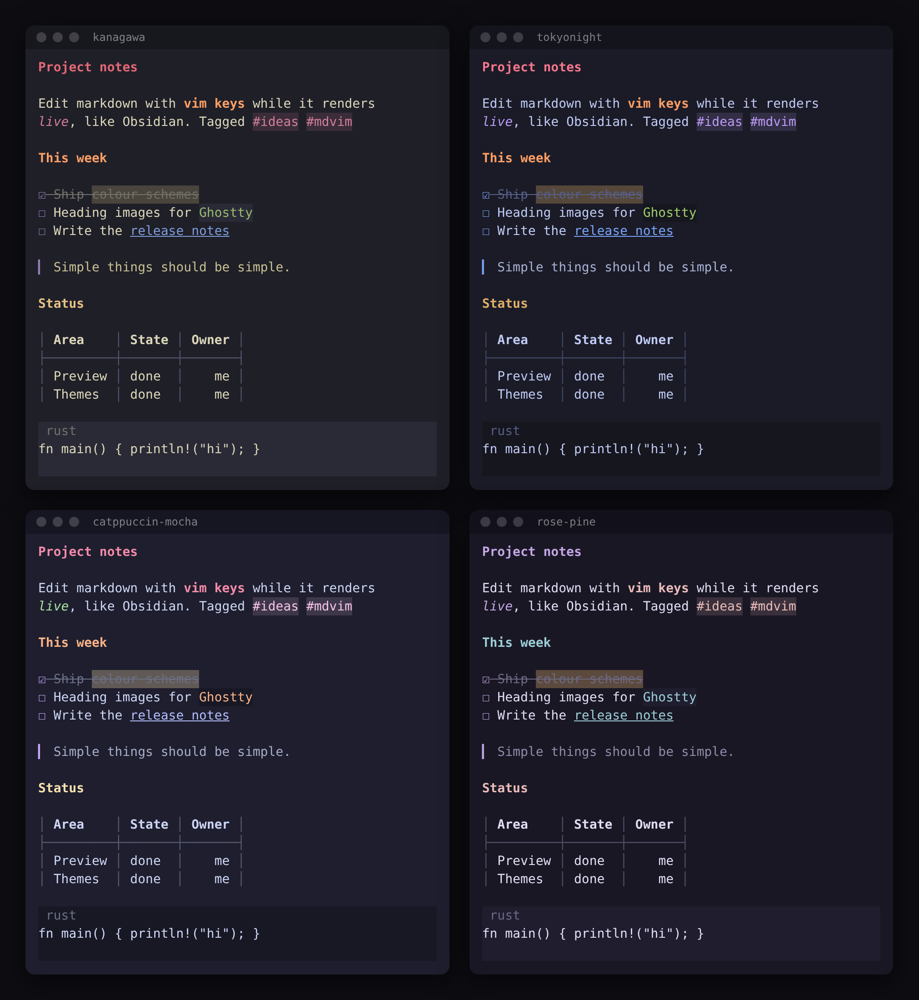

# nib

A vim-style terminal editor with Obsidian-like live markdown preview.



Markdown renders in place as you edit: markers disappear, headings take on
colour and size, tasks become checkboxes and tables get borders. The line
under the cursor, or the whole table or code block it sits in, switches back
to raw source so you can edit it, just like Obsidian. Everything else is
plain modal vim.

- **Live preview** that keeps one source line per display line, so line
  numbers, counts and ranges behave exactly like vim
- **Large headings** in kitty, and in Ghostty and WezTerm, drawn in your
  terminal's own font
- **22 colour schemes** including Kanagawa, Tokyo Night, Catppuccin and
  Rosé Pine, applied the way Obsidian themes are
- **Real vim editing**: motions, operators, text objects, registers, macros,
  marks, visual modes, ex commands, splits and tabs
- **Markdown helpers** for lists, tasks, folding and links
- No plugins, no runtime, one binary

## Install

Requires a recent Rust toolchain.

```sh
git clone https://github.com/mje07/nib
cd nib
cargo install --path .
```

## Usage

```sh
nib notes.md                        # open a file
nib -O a.md b.md                    # vertical splits (-o horizontal, -p tabs)
nib +42 notes.md                    # start at line 42
nib --colorscheme kanagawa notes.md # pick a theme
```

Inside the editor, `:help` lists the essentials, `:preview` toggles live
preview for the window, and `:colorscheme` switches themes.

## Live preview

| You type | You see |
|---|---|
| `# Heading` ... `######` | coloured headings, larger where the terminal allows |
| `**bold**` `*italic*` `~~strike~~` `==highlight==` | styled text, markers hidden |
| `` `code` `` and fenced code | shaded code with a language label |
| `[text](url)` | underlined link text |
| `- item`, `1. item` | bullets and numbers at every depth |
| `- [ ]` / `- [x]` | checkboxes, done items struck through |
| `> quote` | a coloured bar |
| tables | aligned columns with box-drawing borders |
| `#tag`, footnotes, `---` | tag pills, superscripts, full-width rules |

A cursor in a table or code block reveals the whole block. Visual mode
reveals every selected line.

### Heading sizes

Headings shrink from H1 (2x) to H4 (1.25x), as in Obsidian. nib detects
what your terminal can do at startup:

| Terminal | Headings |
|---|---|
| kitty | real large text via the [text sizing protocol](https://sw.kovidgoyal.net/kitty/text-sizing-protocol/) |
| Ghostty, WezTerm | rendered by nib and shown as images via the [graphics protocol](https://sw.kovidgoyal.net/kitty/graphics-protocol/) |
| everything else | normal size, set apart by colour and weight |

In Ghostty the headings use your `font-family` settings, or Ghostty's
built-in JetBrains Mono when none is set. Turn sizing off with
`:set noheadingscale`.

### Markdown helpers

- `Enter` and `o` continue lists, numbered lists, tasks and quotes
- `Tab` / `Shift-Tab` in insert mode indent and outdent list items
- `<leader>x` toggles a task (leader is space)
- `za` `zc` `zo` `zR` `zM` fold heading sections; `]]` `[[` jump between them
- `gf` opens a linked file, `gx` opens a URL
- `gq` reflows text to `textwidth`, keeping list indentation

## Themes

```
:colorscheme catppuccin-mocha   " Tab completes, :colo for short
```

Your choice is remembered for next time. Setting `colorscheme` in
`config.toml` also works; whichever you changed last wins.

| Family | Schemes |
|---|---|
| Terminal | `default`, which uses your terminal's colours |
| Obsidian | `obsidian`, `obsidian-light` |
| Kanagawa | `kanagawa`, `kanagawa-dragon`, `kanagawa-lotus` |
| Tokyo Night | `tokyonight`, `tokyonight-storm`, `tokyonight-moon`, `tokyonight-day` |
| Catppuccin | `catppuccin-mocha`, `catppuccin-macchiato`, `catppuccin-frappe`, `catppuccin-latte` |
| Rosé Pine | `rose-pine`, `rose-pine-moon`, `rose-pine-dawn` |
| Others | `gruvbox`, `gruvbox-light`, `nord`, `dracula`, `everforest` |

Each scheme is a small palette of semantic colours (background, text, accent,
heading colours) that flows into the whole interface, like an Obsidian theme.
Schemes other than `default` need a truecolor terminal.
To write your own, see [themes/README.md](themes/README.md).

## Configuration

nib reads `~/.config/nib/config.toml`. Every key is optional; see
[examples/config.toml](examples/config.toml) for all of them.

```toml
colorscheme = "kanagawa"
leader = " "

[options]
number = true
textwidth = 80

[keymaps.insert]
"jk" = "<Esc>"

[theme]                 # restyle any highlight group
link = { fg = "cyan", underline = true }
```

Run `nib -u NONE` to start without a config.

## Vim support

<details>
<summary>Full list of supported vim features</summary>

**Modes**: normal, insert, replace (`R`), visual (`v`, `V`, `Ctrl-v`),
command line (`:`, `/`, `?`), and `Ctrl-o` from insert.

**Motions**: `h j k l` `w b e ge W B E gE` `0 ^ $ g_ |` `gg G N%`
`f F t T ; ,` `% { } ( ) ]] [[` `H M L` `n N * #` `` `x 'x `` `+ - _ Enter`
`gj gk`, all with counts.

**Operators**: `d c y > < g~ gu gU g? gq gw`, doubled for lines, with any
motion or text object; plus `x X D C s S Y r J gJ ~ p P gp gP` and
`Ctrl-a` / `Ctrl-x`.

**Text objects**: `iw aw iW aW is as ip ap i( a( ib i[ i{ iB i< i" i' i` it at`.

**Visual mode**: all operators, `o` `O`, block `I` `A`, `r`, `J`, `p`,
`u U ~`, `>` `<` with counts, `g Ctrl-a`, `gv`.

**Registers**: `"a`-`"z` (uppercase appends), `"0`-`"9`, `"-` `"_` `".` `":`
`"/`, and `"+` `"*` for the system clipboard (`wl-copy`, `xclip`, `xsel`,
`pbcopy`, or OSC 52).

**Repeat and macros**: `.` with counts, `q{reg}`, `@{reg}`, `@@`, `@:`.

**Undo**: `u`, `Ctrl-r`; each command, insert session or `:g` is one step.

**Marks and jumps**: `m{a-zA-Z}`, `'` and `` ` ``, `''`, `` `. `` `'^` `'[`
`']` `'<` `'>`, `Ctrl-o` / `Ctrl-i`.

**Search**: `/` `?` with incremental highlighting, `n N * #`, `:noh`;
ignorecase and smartcase by default.

**Insert mode**: `Ctrl-w Ctrl-u Ctrl-h Ctrl-t Ctrl-d Ctrl-r{reg} Ctrl-o
Ctrl-v Ctrl-e Ctrl-y Ctrl-a`, `Ctrl-n` / `Ctrl-p` completion with a popup,
autoindent, counted inserts.

**Windows**: `Ctrl-w s v n w W p h j k l t b q c o = + - < > _ | x T`;
`:sp` `:vs` `:new` `:vnew` `:close` `:only` `:resize` `:vertical resize`.

**Tabs**: `gt` `gT` `{N}gt`, `:tabnew` `:tabe` `:tabn` `:tabp` `:tabc`
`:tabo` `:tabfirst` `:tablast`; click the tabline to switch.

**Buffers**: `:e` `:e!` `:enew` `:ls` `:b N|name` `:bn` `:bp` `:bd[!]` `Ctrl-^`.

**Ex commands**, with ranges (`N . $ % 'a '<,'> /pat/ ?pat? +N -N`):
`:w` `:wq` `:x` `:q` `:qa` `:wa` `:wqa` `:up` `:sav` `:r file` `:r !cmd`
`:!cmd` `:{range}!filter` `:s` (with `\1 & \u \U \l \L \e \r`) `:&` `:&&`
`:g` `:v` `:d` `:y` `:pu` `:m` `:t` `:co` `:j` `:>` `:<` `:norm` `:sort`
`:retab` `:set` `:setlocal` `:map` / `:noremap` families and `:unmap`, `:reg`
`:marks` `:jumps` `:mark` `:=` `:cd` `:pwd` `:colorscheme` `:help`.
The command line has history, `Tab` completion and `Ctrl-r {reg}`.

**Mouse**: click, drag to select, wheel to scroll. Bracketed paste.
`Ctrl-z` suspends.

</details>

### Differences from Neovim

- No plugins, Lua, LSP, tree-sitter, `:terminal`, spell checking or swap files
- Patterns use Rust regex syntax (`(a|b)+`, `\d`); `\<` `\>` `\c` `\C` are translated
- Linear undo, no undo tree
- Folds come from markdown headings only
- Syntax highlighting is markdown-only

## Development

```sh
cargo test
cargo clippy -- -D warnings
```

The editor core in `src/editor` is a terminal-independent state machine
driven by `Editor::handle_key`. `src/ui` draws it with ratatui,
`src/markdown` turns the buffer into style and conceal annotations with
pulldown-cmark, and `src/headings.rs` renders the image headings.

The bundled JetBrains Mono font is under the
[SIL Open Font License](assets/fonts/JetBrainsMono-OFL.txt).
